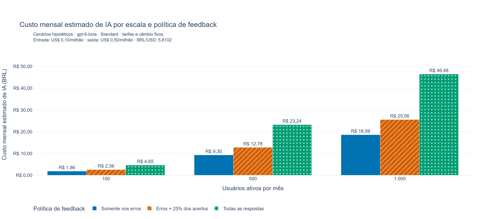

# LiteArt Cost Analytics

Projeto pessoal para aprender Python e Análise de Dados a partir dos custos de feedbacks de IA
do LiteArt, uma plataforma educacional em desenvolvimento.

O **MVP v0.1.0 é uma calculadora de terminal publicada no GitHub**. O estudo de caso é uma análise
separada, publicada no mesmo repositório, que reutiliza as funções da calculadora sem alterar a
versão do MVP. Não há dashboard hospedado.

## Relatório do estudo de caso

**[Ler o relatório: custos estimados dos feedbacks de IA do LiteArt](RELATORIO_ESTUDO.md)**

O relatório reúne pergunta, dados, método, resultados, dois gráficos, recomendações e limitações.
Compara nove cenários de escala/política e quatro variações de tokens, todos hipotéticos.



O estudo está publicado no GitHub e foi utilizado como capstone na conclusão do
**Google Data Analytics Professional Certificate**.

## Funcionalidades atuais

- Importar vários cenários de um CSV ou preencher um cenário pelo terminal.
- Validar nome, usuários, respostas, taxas e tokens, repetindo entradas manuais inválidas.
- Consultar a última cotação diária disponível do BCB/SGS série 1 ou informar BRL por USD.
- Calcular feedbacks, tokens e custos mensais e anuais de IA em USD e BRL.
- Exibir uma tabela na ordem dos cenários, com apresentação monetária brasileira.
- Exportar os nove campos da tabela para `resultados/cenarios.csv`.

No estudo, `analise_estudo.py` valida entradas próprias, calcula comparações de políticas,
sensibilidade e indicadores. `graficos_estudo.py` gera os dois gráficos interativos em HTML.
Essas rotinas são separadas do menu do MVP.

## Instalação e exemplo de execução

### Preparar uma cópia do projeto

Ambiente validado: **Python convencional 3.14.10 x64 e Windows 11, build 26300**.
Outras versões e sistemas não foram validados. Instale o Python convencional antes de começar.

Abra o PowerShell e obtenha o projeto:

```powershell
git clone https://github.com/MrNemo31/Calculadora-LiteArt-Cost-Analytics.git LiteArt-Cost-Analytics
Set-Location -LiteralPath '.\LiteArt-Cost-Analytics'
```

Como alternativa, use uma cópia completa dos arquivos, incluindo `dados/`, `docs/` e `tests/`.
Não copie ambientes virtuais nem resultados pessoais.

**Todos os comandos abaixo partem da raiz do projeto.** Para uma cópia sem `.venv-win`, informe
o caminho completo do Python convencional e prepare o ambiente:

```powershell
$pythonBase = Read-Host 'Caminho completo do python.exe convencional (Python 3.14.10 x64)'
& $pythonBase -X utf8 -B -c "import sys, sysconfig; print(sys.executable); print(sys.version); print(sysconfig.get_platform())"
& $pythonBase -X utf8 -B -m venv .venv-win
$pythonProjeto = (Resolve-Path -LiteralPath '.\.venv-win\Scripts\python.exe').Path
& $pythonProjeto -X utf8 -B -m pip install -r requirements.txt
& $pythonProjeto -X utf8 -B -m pip check
& $pythonProjeto -X utf8 -B calculadora.py
```

Confira o resultado de cada comando. A plataforma validada é `win-amd64`.
Se o ambiente já existe, preserve-o e comece pela definição de `$pythonProjeto`, sem recriá-lo
ou reinstalar pacotes desnecessariamente. Não é preciso ativar o ambiente, mudar PATH ou alterar
a política de execução do PowerShell. No VS Code, selecione esse Python em **Select Interpreter**.

[requirements.txt](requirements.txt) fixa Pandas e Plotly, dependências diretas, e suas dependências
indiretas. Módulos da biblioteca padrão não entram no arquivo. Ele ajuda a reproduzir o conjunto
validado, mas não é um lock completo nem garante compatibilidade universal. O preparo limpo de
14/11/2026 validou o conjunto original do MVP; não foi repetido após a inclusão do Plotly.

Instalar pacotes pode exigir internet. A consulta ao BCB também exige rede; depois da instalação,
o modo com cotação manual funciona sem internet. Não há chamadas reais às APIs dos modelos de IA.

### Exemplo reproduzível do MVP

Para usar o CSV de exemplo, escolha **1** no menu de cenários, **2** no menu de cotação e digite
`5.00`. Essa taxa é didática, não uma cotação atual.

| Usuários | Feedbacks/mês | IA mensal (USD) | IA mensal (BRL) | IA anual (USD) | IA anual (BRL) |
| --- | ---: | ---: | ---: | ---: | ---: |
| 100 | 2200 | US$ 0,44 | R$ 2,20 | US$ 5,28 | R$ 26,40 |
| 500 | 11000 | US$ 2,20 | R$ 11,00 | US$ 26,40 | R$ 132,00 |

Para preencher manualmente, escolha **2** e responda, na ordem: `Cenário manual`, `100`, `40`,
`0.60`, `0.25`, `500`, `300`. Depois escolha **2** para cotação e informe `5.00`.
Esse modo usa um cenário por execução e não exige o CSV.

### Entradas, precisão e arquivos

[dados/cenarios_exemplo.csv](dados/cenarios_exemplo.csv) contém nome e seis hipóteses, nesta ordem:

```text
cenario,usuarios_ativos,respostas_por_usuario,taxa_acerto,proporcao_acertos_com_feedback,tokens_entrada,tokens_saida
```

Use UTF-8, vírgula entre campos, ponto decimal e números sem separadores de milhares.
As unidades são usuários/mês, respostas por usuário/mês e tokens por feedback. Taxas são
proporções entre 0 e 1: `0.60` significa 60%. Usuários precisam ser inteiros não negativos;
`100.0` e `100.5` são rejeitados. As médias podem ser fracionárias. Campos vazios, números
negativos, infinito, NaN e taxas fora do intervalo são rejeitados.

Todo erro recebe feedback; nos acertos, aplica-se a proporção informada. `0.25` significa
feedback em 25% dos acertos, não 25% dos usuários com uma opção ativada.

Valores financeiros permanecem como **Decimal**. Duas casas e os símbolos `R$`/`US$` são
formatação de apresentação; o CSV recebe valores completos, sem símbolos ou milhares.
CSV armazena texto: para recuperar a precisão financeira, leia os campos como texto e converta
diretamente para Decimal, sem passar por float.

O caminho `resultados/cenarios.csv` parte da pasta do script, mesmo com o terminal em outra
pasta. Uma execução concluída cria o diretório se necessário e substitui o arquivo anterior,
sem acumular linhas. Erros de entrada e cancelamento preservam os resultados anteriores.
Se a consulta cambial falhar, há opção manual ou cancelamento, sem taxa substituta inventada.
O esquema das nove colunas está nas [notas da versão](docs/RELEASE_NOTES.md).

## Executar análise, gráficos e testes

Com a `.venv-win` já preparada, use o executável diretamente, a partir da raiz:

```powershell
& '.\.venv-win\Scripts\python.exe' -X utf8 -B analise_estudo.py
& '.\.venv-win\Scripts\python.exe' -X utf8 -B graficos_estudo.py
& '.\.venv-win\Scripts\python.exe' -X utf8 -B -m unittest discover -s tests -t . -v
```

Para executar somente um módulo de testes:

```powershell
& '.\.venv-win\Scripts\python.exe' -X utf8 -B -m unittest tests.test_calculadora -v
& '.\.venv-win\Scripts\python.exe' -X utf8 -B -m unittest tests.test_analise_estudo -v
& '.\.venv-win\Scripts\python.exe' -X utf8 -B -m unittest tests.test_graficos_estudo -v
```

O estudo lê [cenarios.csv](dados/estudo_de_caso/cenarios.csv), com 13 cenários, e
[condicoes_fixas.csv](dados/estudo_de_caso/condicoes_fixas.csv), com uma configuração comum.
Mantém GPT-6 Luna, Standard, tarifas de USD 0.10/0.50 por milhão de tokens de entrada/saída
e cotação de **5.8102 BRL/USD**, com pesquisa e referência de **18/11/2026**.
Essas condições históricas não são atualizadas automaticamente. O campo adicional `id_cenario`
torna a entrada do estudo incompatível diretamente com o importador do MVP.

A análise gera quatro CSVs em `resultados/estudo_de_caso/`:

- `resultados_cenarios.csv`
- `comparacao_politicas.csv`
- `sensibilidade_tokens.csv`
- `indicadores_cenarios.csv`

Depois, o comando dos gráficos gera `custo_mensal_por_escala_politica.html` e
`sensibilidade_tokens.html` nessa pasta. Abra os HTMLs manualmente no navegador; eles incorporam
Plotly e funcionam offline. CSVs gerados e HTMLs ficam fora do Git e podem ser regenerados.
As imagens de `docs/imagens/` acompanham o relatório publicado.

**Evidência histórica:** em **25/11/2026**, passaram **290 métodos em 21 classes**: 188 do MVP,
66 da análise e 36 dos gráficos. A reorganização em `tests/` preservou a contagem e aprovou
também a descoberta padrão e os módulos individuais. Os testes do BCB usam respostas simuladas.
Esses testes não foram executados novamente na revisão documental de 26/11/2026.
Os registros estão em [PROMPTS.md](docs/PROMPTS.md).

## Limitações

Os cenários são hipotéticos, sem uso real medido ou avaliação de aprendizagem. Menor custo não
comprova qualidade pedagógica superior. As estimativas cobrem somente IA; infraestrutura e demais
despesas estão excluídas. O anual supõe 12 meses constantes. Tarifas e câmbio são referências
datadas, e a cotação diária do BCB não é tempo real nem garante o valor de um pagamento.
As recomendações são condicionais; piloto e coleta de dados continuam propostas futuras.

## Documentação, próximos passos e licença

- [Relatório](RELATORIO_ESTUDO.md): narrativa, método, resultados, figuras e recomendações.
- [Estudo de caso](docs/ESTUDO_DE_CASO.md): metodologia, matriz, fontes e verificações.
- [Interpretação](docs/INTERPRETACAO_ESTUDO.md): leitura aprofundada e propostas condicionais.
- [Planejamento](docs/PLANEJAMENTO.md): situação atual, decisões, referências técnicas e roteiro.
- [Notas da v0.1.0](docs/RELEASE_NOTES.md): entrega publicada e preparação histórica.
- [Prompts](docs/PROMPTS.md): desenvolvimento e apoio de IA.

O MVP e o estudo publicados podem evoluir em incrementos próprios. Como melhorias futuras estão
catálogo e seleção de modelos, comparação entre provedores, exportação automática
de imagens, dashboard e retomada de infraestrutura/orçamento. A medição de uso e qualidade exige
um piloto próprio, ainda não realizado.

O código usa a [licença MIT](LICENSE), com uso, modificação e distribuição, inclusive comercial,
mantendo os avisos exigidos. Dependências e fontes de dados conservam suas próprias condições.
