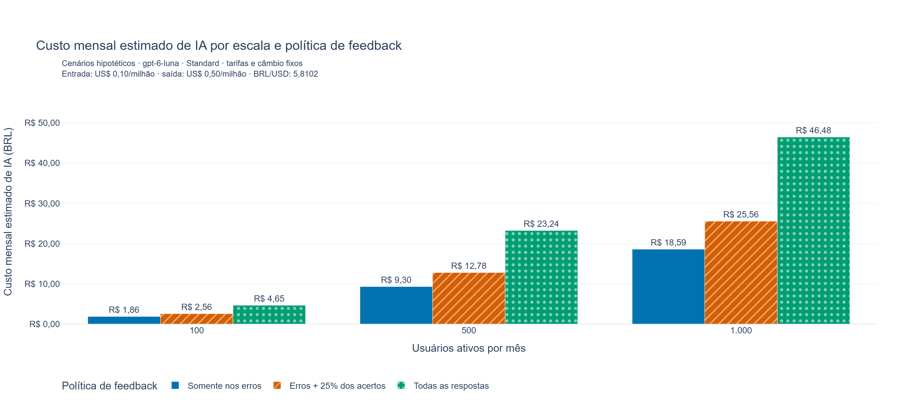
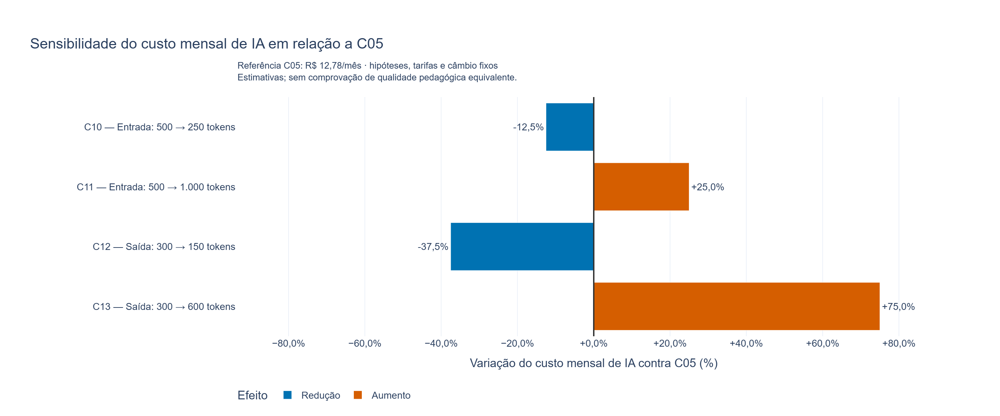

# Custos estimados dos feedbacks de IA do LiteArt

**Relatório do estudo de caso — preparado em 25/11/2026 e publicado no repositório GitHub.**
Condições históricas de preços e câmbio: 18/11/2026. Não houve atualização dessas referências.

**Estado confirmado em 26/11/2026:** o responsável informou a publicação e a conferência das
imagens e links na apresentação publicada. Concluiu o Google Data Analytics Professional
Certificate utilizando o estudo como capstone, sem data exata informada. Isso não demonstra
avaliação individual deste relatório, nota ou endosso do Google.

## 1. Resumo

**Como a quantidade de usuários, a política de feedback nos acertos e o consumo de tokens afetam
o custo mensal estimado de IA do LiteArt?** Nos 13 cenários hipotéticos, o custo cresce
proporcionalmente aos usuários quando as outras hipóteses permanecem iguais. Oferecer feedback
somente nos erros reduz o custo em **60%** contra todas as respostas; incluir também 25% dos
acertos reduz em **45%**, sempre comparando a mesma escala.

Em C05, com 500 usuários, a estimativa mensal é **US$ 2,20 / R$ 12,78**. A saída representa 75%
desse custo: reduzir sua hipótese de 300 para 150 tokens por feedback reduz o total em 37,5%.
Reduzir a entrada de 500 para 250 tokens reduz o total em 12,5%. As diferenças decorrem das
fórmulas, das tarifas e das hipóteses, sem observação do comportamento dos estudantes.

A proposta é usar essas estimativas para planejar a parcela de IA e priorizar medições de uso,
tokens faturáveis e qualidade antes de adotar uma política. Menor custo não demonstra melhor
aprendizagem. **O estudo cobre somente IA**, sem infraestrutura ou custo operacional completo.
Este relatório não comprova eficácia pedagógica nem aprovação pelas exigências do curso.

## 2. Contexto e objetivo

O LiteArt é uma plataforma educacional em desenvolvimento. Feedbacks gerados por IA podem ajudar
a explicar respostas, mas sua frequência e seu consumo de tokens influenciam o planejamento
financeiro. A decisão apoiada é dimensionar essa parcela do orçamento e identificar quais
hipóteses precisam ser medidas antes do lançamento.

O estudo utiliza funções da calculadora de terminal LiteArt Cost Analytics e uma rotina separada,
[analise_estudo.py](analise_estudo.py). A **v0.1.0 permanece o MVP publicado**; o estudo não altera
essa versão nem representa uma nova release. Não foram feitas chamadas às APIs dos modelos,
avaliações com estudantes ou comparações de qualidade entre modelos.

## 3. Dados e método

### Fontes e condições históricas

A pesquisa documental registrada em [ESTUDO_DE_CASO.md](docs/ESTUDO_DE_CASO.md) definiu as condições
abaixo, compartilhadas pelos 13 cenários. Os registros estão em
[condicoes_fixas.csv](dados/estudo_de_caso/condicoes_fixas.csv).

| Condição | Referência adotada |
| --- | --- |
| Provedor e modelo | OpenAI, API direta, GPT-6 Luna (`gpt-6-luna`) |
| Modalidade | Standard, texto, requisições curtas; entrada sem cache |
| Entrada | US$ 0,10 por milhão de tokens |
| Saída faturável | US$ 0,50 por milhão de tokens |
| Pesquisa de preços | 18/11/2026 |
| Cotação fixa | 5,8102 BRL por USD, BCB/SGS série 1, dólar americano de venda diário |
| Observação e consulta cambial | Ambas em 18/11/2026; sem horário registrado |

As fontes oficiais preservadas são a [página do modelo](https://developers.openai.com/api/docs/models/gpt-6-luna),
a [tabela de preços](https://developers.openai.com/api/docs/pricing) e o
[catálogo BCB/SGS série 1](https://dadosabertos.bcb.gov.br/dataset/1-taxa-de-cambio---livre---dolar-americano-venda---diario).
Esses links identificam a proveniência histórica, sem nova pesquisa nesta tarefa ou garantia de
preços, câmbio e disponibilidade atuais. O endpoint cambial dinâmico não atualiza a taxa do estudo.
A presença do modelo no catálogo não comprova acesso pela conta responsável.

Preços e câmbio são referências pesquisadas; modelo e modalidade são configurações escolhidas
para manter comparabilidade. Usuários, respostas, acertos e tokens são **hipóteses**, não medidas.
Consumos, custos e indicadores são resultados derivados. A cotação didática de R$ 5,00 dos
exemplos do MVP não é usada neste estudo.

### Cenários e comparações

[cenarios.csv](dados/estudo_de_caso/cenarios.csv) contém 13 combinações distintas, com uma linha
por cenário mensal. Todos usam 40 respostas por usuário/mês, taxa de acerto de 60%, feedback em
todos os erros e uma chamada por feedback, sem novas tentativas.

- **C01 a C09:** cruzam 100, 500 e 1.000 usuários com três políticas: somente erros, erros mais
  25% dos acertos e todas as respostas. Usam 500 tokens de entrada e 300 de saída por feedback.
- **C10 a C13:** mantêm as hipóteses de C05 e alteram um consumo por vez: entrada de 250 ou
  1.000 tokens; saída de 150 ou 600 tokens, respectivamente.
- **Referências:** C03 para políticas com 100 usuários, C06 para 500 e C09 para 1.000, todos com
  feedback em todas as respostas. C05 é a referência da sensibilidade.

Os níveis de usuários são alternativas, não meses sucessivos nem previsão de crescimento.
A proporção de 25% corresponde aos **acertos que recebem feedback**, não aos usuários com toggle
ligado. Supõe-se o mesmo consumo por feedback de acerto e erro, algo ainda não medido.

### Preparação, cálculo e precisão

As entradas foram separadas entre hipóteses e condições comerciais, identificadas por C01 a C13
e validadas quanto a esquema, campos obrigatórios, tipos, unicidade, intervalos, datas e números
finitos. As comparações também validam hipóteses e condições compatíveis. A preparação e as
verificações detalhadas estão em [ESTUDO_DE_CASO.md](docs/ESTUDO_DE_CASO.md).

A rotina reaproveita o cálculo de consumo e de IA do MVP. Calcula feedbacks a partir dos erros
e dos acertos contemplados, multiplica pelos tokens por feedback, aplica as tarifas por milhão
e converte USD para BRL. A projeção anual é o mensal multiplicado por 12, sob condições constantes.

Tarifas, câmbio e custos são convertidos diretamente de texto para `Decimal`, sem float
intermediário. As divisões usam a precisão vigente do contexto Decimal; na conferência dos
arquivos, foram usados 28 dígitos. Dízimas não têm representação decimal finita exata. Um
denominador zero gera indicador não aplicável, exportado vazio, diferente de um valor zero.
Nos arquivos atuais, os denominadores são positivos.

Os CSVs preservam os valores completos. Neste relatório, arredondamentos ocorrem somente na
apresentação: duas casas nos rótulos monetários das figuras, mais casas nas tabelas e oito nos
custos por usuário. A cópia numérica usada para desenhar barras pode usar float; ela não alimenta
cálculos nem exportações financeiras. Não se somam custos de cenários alternativos.

## 4. Resultados

### Políticas: menos feedbacks reduzem o custo sob tokens iguais por chamada



**Figura 1 — Custo mensal estimado de IA por escala e política.** Retrato das condições de
18/11/2026. Fonte: C01 a C09 de `resultados/estudo_de_caso/resultados_cenarios.csv`, gerado pela
rotina do estudo. Barras lado a lado representam alternativas; o eixo monetário começa em zero.
Os valores abaixo permitem comparar políticas sem depender de cores ou hover.

| Usuários | Somente erros | Erros + 25% dos acertos | Todas as respostas, referência |
| --- | ---: | ---: | ---: |
| 100 | C01: R$ 1,859264 | C02: R$ 2,556488 | C03: R$ 4,648160 |
| 500 | C04: R$ 9,296320 | C05: R$ 12,782440 | C06: R$ 23,240800 |
| 1.000 | C07: R$ 18,592640 | C08: R$ 25,564880 | C09: R$ 46,481600 |

Fonte das seis comparações: `resultados/estudo_de_caso/comparacao_politicas.csv`.
Em cada escala, somente erros reduz em **60%** contra a referência; erros mais 25% dos acertos
reduz em **45%**. A redução absoluta é `custo_referencia - custo_politica`; o percentual divide
essa diferença pelo custo da referência **na mesma escala** e multiplica por 100.

Por exemplo, C06 custa US$ 4,00 / R$ 23,240800 por mês e C05 custa US$ 2,20 / R$ 12,782440.
A redução é **R$ 10,458360**, e `10.458360 / 23.240800 × 100 = 45%`. A diferença é calculada
com os valores completos, não subtraindo os rótulos já arredondados para duas casas.

Com 60% de acerto, os erros correspondem a 40% das respostas. Acrescentar feedback em 25% dos
acertos atende mais 15% das respostas, chegando a 55%. Mantendo tokens iguais por feedback,
permanecem 40% ou 55% do custo da política que cobre tudo. Essas relações não se generalizam
para outras taxas de acerto, consumos diferentes por tipo de feedback ou custos de infraestrutura.

### Sensibilidade: alterar tokens e alterar o custo total são coisas diferentes



**Figura 2 — Variação do custo mensal de IA em relação a C05.** Retrato das condições de
18/11/2026. Fonte: `resultados/estudo_de_caso/sensibilidade_tokens.csv`. O eixo é percentual,
linear e centrado em zero. Os identificadores, as alterações e os sinais estão nos rótulos.

| Cenário | Alteração contra C05 por feedback | Variação dos tokens alterados | IA mensal (BRL) | Diferença contra C05 (BRL) | Variação do custo |
| --- | --- | ---: | ---: | ---: | ---: |
| C10 | Entrada: 500 → 250; saída 300 | -50% | 11,184635 | -1,597805 | -12,5% |
| C11 | Entrada: 500 → 1.000; saída 300 | +100% | 15,978050 | +3,195610 | +25% |
| C12 | Saída: 300 → 150; entrada 500 | -50% | 7,989025 | -4,793415 | -37,5% |
| C13 | Saída: 300 → 600; entrada 500 | +100% | 22,369270 | +9,586830 | +75% |

Aqui, a diferença é `custo_cenario - custo_C05`, com sentido inverso ao da redução das políticas.
O denominador do percentual é sempre **C05: R$ 12,782440 por mês**. Por exemplo, C12 fica
R$ 4,793415 abaixo da referência: `-4.793415 / 12.782440 × 100 = -37.5%`.

Em C05, os componentes mensais são **US$ 0,55 de entrada (25%)** e **US$ 1,65 de saída (75%)**,
totalizando US$ 2,20. Assim, cortar metade da entrada afeta metade de 25% do custo; cortar metade
da saída afeta metade de 75%. Dobrar os componentes produz aumentos de 25% e 75%, respectivamente.
Essas participações usam componente e total na mesma moeda, USD.

A saída não representa 75% em todas as variações: corresponde a 60% em C11/C12 e aproximadamente
85,71% em C10/C13. Os tokens são hipóteses exploratórias, sem garantia de qualidade equivalente;
as variações não são intervalos estatísticos de confiança ou limites garantidos de geração.

### Escala e custo mensal por usuário ativo

Fonte: `resultados/estudo_de_caso/indicadores_cenarios.csv`. Comparando a mesma política,
100 → 500 usuários multiplica o custo por cinco; 500 → 1.000 multiplica por dois. O denominador
do custo unitário é a quantidade de **usuários ativos**, não a de feedbacks.

| Política | Cenários comparáveis | USD/usuário ativo/mês | BRL/usuário ativo/mês |
| --- | --- | ---: | ---: |
| Somente erros | C01/C04/C07 | 0,00320000 | 0,01859264 |
| Erros + 25% dos acertos | C02/C05/C08 | 0,00440000 | 0,02556488 |
| Todas as respostas | C03/C06/C09 | 0,00800000 | 0,04648160 |

O custo por usuário é constante dentro de cada política porque respostas, acertos, tokens,
tarifas e câmbio permanecem iguais. Não há desconto por volume ou custo fixo de IA diluído neste
modelo: **isso não demonstra economia de escala**. Comparar escalas com políticas diferentes
não permitiria atribuir a diferença somente ao número de usuários. Os custos unitários cobrem
somente IA; as oito casas preservam a leitura dos valores em USD inferiores a um centavo.

## 5. Recomendações condicionais

As propostas seguem [INTERPRETACAO_ESTUDO.md](docs/INTERPRETACAO_ESTUDO.md). Nenhuma foi tratada como
decisão definitivamente adotada, orçamento máximo ou meta pedagógica aprovada.

| Evidência | Ação proposta | Condição ou limite | Dado para revisar a proposta |
| --- | --- | --- | --- |
| Somente erros custa 60% menos que todas as respostas, nas mesmas escalas e tokens | Incluir essa política entre alternativas a avaliar | Menor custo não define a melhor política pedagógica; não reduzir feedback automaticamente | Necessidade e utilidade das explicações em acertos e erros, compreensão dos estudantes |
| C05 reduz 45% contra C06; contra C04 acrescenta 3.000 feedbacks e R$ 3,486120/mês | Avaliar feedback opcional nos acertos | A proporção de acertos com feedback depende do uso; não equivale a usuários com toggle ligado | Acertos elegíveis, acertos com feedback, toggle por interação e utilidade percebida |
| C05 tem 25% de custo de entrada e 75% de saída, sob tokens não medidos | Medir tokens faturáveis antes de definir limites | Considerar entrada completa e toda a saída faturável, incluindo componentes não visíveis sem dupla contagem | Tokens por chamada e por feedback de acerto/erro, configuração e respostas incompletas |
| C12 reduz 37,5% ao supor metade da saída, sem medir qualidade | Avaliar clareza e concisão junto da qualidade | Não cortar explicações necessárias nem presumir que 150 tokens bastam; mais tokens não garantem qualidade | Correção, clareza, utilidade, omissões e tokens das versões avaliadas |
| C02/C05/C08 têm custos proporcionais à escala e custo unitário constante | Planejar a parcela de IA com hipóteses explícitas e revisá-las após medições | Não somar alternativas nem tratar estimativas como custo operacional completo ou previsão de crescimento | Usuários ativos, respostas mensais, feedbacks, consumo faturável, falhas e despesas excluídas |

## 6. Limitações e próximos dados

Não há utilização real, contagem medida de tokens ou avaliação de aprendizagem. Os cenários não
constituem uma amostra estatística de estudantes. Diferenças determinadas pelas fórmulas não
sustentam generalização sobre comportamento, testes de significância ou comprovação pedagógica.

Os resultados dependem de um modelo, tarifas e câmbio históricos. Não foram comprovados acesso
pela conta, configuração de raciocínio ou qualidade equivalente entre variações. A saída inclui
todo o consumo faturável; o texto visível pode ser menor. Requisições curtas são uma hipótese,
e os totais mensais de tokens não são o contexto de uma única chamada.

Ficam excluídos infraestrutura, demais despesas operacionais, tributos, adicionais de pagamento,
ferramentas, cache e modalidades como Batch, Flex e modos acelerados. A taxa de simulação não
garante o câmbio de um pagamento. O anual pressupõe 12 meses constantes, sem sazonalidade,
crescimento ou mudanças de preços e câmbio. O estudo não demonstra viabilidade financeira.

Um piloto futuro deverá registrar:

- Usuários ativos por mês, respostas por usuário e distribuição do volume de uso.
- Taxa de acerto e proporção dos acertos elegíveis que recebem feedback, separadas da configuração
  do toggle e do percentual de usuários que o deixam ligado.
- Tokens faturáveis de entrada e saída por chamada, separados por feedback de acerto/erro;
  esses consumos podem ser diferentes, exigindo revisão da média única.
- Falhas, novas tentativas e geração duplicada, conferindo eventuais efeitos na cobrança.
- Modelo, configuração, preços, unidades e referência cambial aplicáveis à execução.
- Correção, clareza e utilidade pedagógica dos feedbacks, com critérios a definir antes da coleta.

Esse plano não foi executado. Não há participantes, tamanho de amostra suficiente ou resultados
de piloto estabelecidos. Satisfação e correção textual não comprovam, sozinhas, aprendizagem.
Uma avaliação de resultados educacionais exigirá desenho próprio antes da coleta.

## 7. Reprodução e apoio de IA

### Arquivos e comandos

O [README](README.md) apresenta o preparo completo do ambiente. Em uma cópia do projeto, com
Python convencional instalado e sem `.venv-win` existente, executar os comandos PowerShell abaixo
**a partir da raiz do projeto**, onde estão os três scripts. Os testes estão em `tests/` e a
documentação de apoio em `docs/`; os comandos refletem essa organização atual.

```powershell
$pythonBase = Read-Host 'Caminho completo do python.exe convencional (Python 3.14.10 x64)'
& $pythonBase -m venv .venv-win
$pythonProjeto = (Resolve-Path -LiteralPath '.\.venv-win\Scripts\python.exe').Path
& $pythonProjeto -X utf8 -B -m pip install -r requirements.txt
& $pythonProjeto -X utf8 -B -m pip check
& $pythonProjeto -X utf8 -B analise_estudo.py
& $pythonProjeto -X utf8 -B graficos_estudo.py
& $pythonProjeto -X utf8 -B -m unittest discover -s tests -t . -v
```

Preservar ambientes existentes. Se `.venv-win` já estiver preparada, começar pela definição de
`$pythonProjeto`, sem recriar o ambiente ou reinstalar pacotes desnecessariamente. Não é preciso
ativar o ambiente ou mudar a política do PowerShell. Os comandos acima são instruções para
reprodução, não uma instalação ou execução realizada na preparação deste relatório.

Executar a análise gera os quatro CSVs abaixo. Executar os gráficos em seguida lê os resultados
e gera os dois HTMLs offline. As saídas são relativas à pasta dos scripts e cada execução as
substitui, sem acumular linhas. As condições do estudo são lidas dos arquivos fixos, sem rede.

| Arquivo em `resultados/estudo_de_caso/` | Conteúdo |
| --- | --- |
| `resultados_cenarios.csv` | 13 linhas e 35 colunas: hipóteses, consumos, custos, condições e proveniência |
| `comparacao_politicas.csv` | Seis linhas e 20 colunas: referências, custos e reduções |
| `sensibilidade_tokens.csv` | Quatro linhas e 24 colunas: tokens, referências e variações |
| `indicadores_cenarios.csv` | 13 linhas e 11 colunas: bases, participações e custos por usuário |
| `custo_mensal_por_escala_politica.html` | Gráfico interativo de C01 a C09 |
| `sensibilidade_tokens.html` | Gráfico interativo de C10 a C13 contra C05 |

Essas saídas ficam ignoradas pelo Git e não devem ser presumidas presentes no GitHub. Os CSVs
de entrada vinculados na seção 3 permitem reproduzi-las com o código correspondente. O arquivo
de cenários do estudo tem `id_cenario` adicional e não é aceito diretamente pelo importador do MVP.
Abrir os HTMLs manualmente no navegador permite usar hover e interações, com Plotly incorporado.
As duas imagens deste relatório estão em `docs/imagens/`, fora de `resultados/`, para acompanhar
o Markdown no versionamento. As figuras podem ser abertas em tamanho original para ampliar.

### Ambiente e evidências disponíveis

O MVP foi validado em ambiente novo em **14/11/2026**, com Python convencional **3.14.10 x64** e
**Windows 11, build 26300**. Plotly e suas dependências foram acrescentados em 19/11/2026;
a instalação limpa original não foi repetida para esse conjunto ampliado. Não se promete
compatibilidade com outros sistemas ou versões. As versões fixadas estão em
[requirements.txt](requirements.txt); instalar pacotes pode exigir internet, enquanto o estudo
com condições fixas não consulta a rede.

O histórico registra **290 métodos de teste em 21 classes aprovados em 25/11/2026**: 188 do MVP,
66 da análise e 36 dos gráficos. Subtests não são métodos adicionais. Essa execução é anterior
ao relatório; a suíte não foi repetida aqui, pois nenhum código foi alterado. Os detalhes estão
no [README](README.md) e em [PROMPTS.md](docs/PROMPTS.md).

Na preparação deste relatório, a conferência pontual releu os seis CSVs e verificou, diretamente
com Decimal, consumos e custos dos 13 cenários, seis reduções, quatro sensibilidades e 13
indicadores, sem divergências. Foram conferidas as condições repetidas nos resultados contra a
entrada fixa. Não houve nova execução da rotina de análise ou consulta de preços/câmbio.

As imagens foram exportadas dos HTMLs existentes com `Plotly.toImage()` no Chrome instalado,
com a página offline, sem redesenhar figuras ou instalar ferramentas. Têm **2880×1300** e
**2880×1200 pixels**, respectivamente. A inspeção dos PNGs conferiu títulos, legendas, eixos,
acentos, rótulos e as nove/quatro barras, sem cortes ou sobreposições observados. A conferência
dos valores da figura utilizou as séries renderizadas e os CSVs. Isso é distinto dos testes
estruturais e da revisão interativa anterior registrada no estudo, de 19/11/2026.

### Apoio de IA e situação da entrega

O projeto utiliza apoio de IA para orientação, explicações, implementação, testes e revisão,
conforme o [histórico de prompts](docs/PROMPTS.md). A elaboração desta síntese também contou com IA
para organizar o texto, conferir aritmética e exportar as figuras. Isso não atribui ao estudante
verificações pessoais ou decisões que não foram confirmadas.

O relatório reúne o planejamento, os resultados e a
[interpretação fundamentada](docs/INTERPRETACAO_ESTUDO.md), com recomendações ainda propostas.
A publicação e o uso como capstone foram confirmados pelo responsável, assim como a conclusão do
certificado. São confirmações posteriores à preparação de 25/11/2026, sem data exata de publicação
ou conclusão informada. Não se infere nota, avaliação individual deste relatório ou endosso do
Google. Nenhum piloto, coleta de dados ou avaliação pedagógica foi realizado. As verificações
históricas descritas neste relatório não foram executadas novamente nesta atualização documental.
